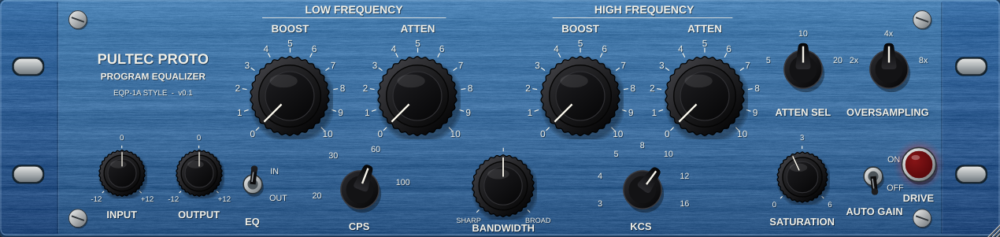
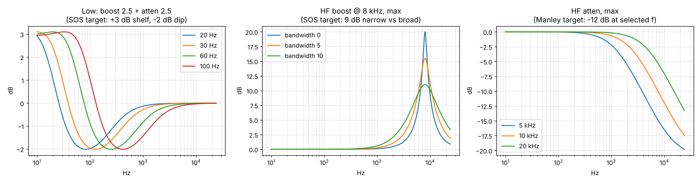
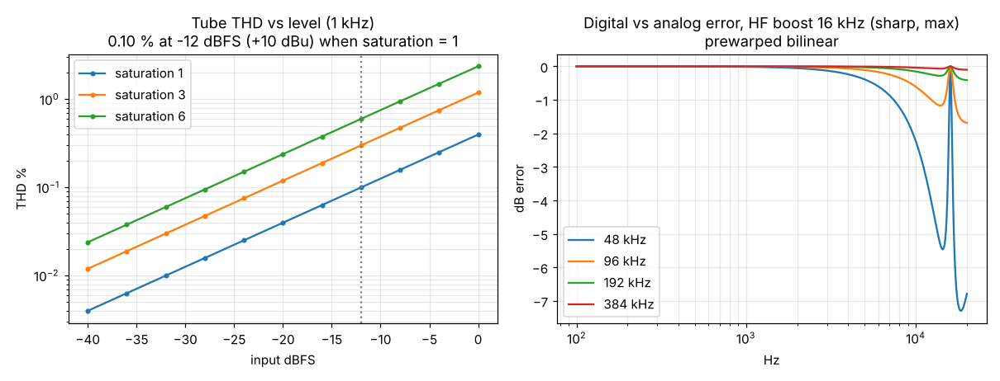

# Pultec Proto — emulación de ecualizador Pultec EQP-1A

Prototipo de un plugin de EQ estilo Pultec EQP-1A: modelo en **Python** (para diseñar y
calibrar), **núcleo DSP en C++** (verificado contra Python) y **plugin VST3/AU/Standalone con JUCE**
que compila automáticamente en GitHub Actions.

> **Estado: v0.1, prototipo.** La estructura y los objetivos de calibración vienen de fuentes
> publicadas (ver `docs/SPEC.md`), pero **los valores de componentes del esquema original no se
> han podido obtener**, así que los filtros son un modelo *conductual* ajustado a curvas medidas,
> no una réplica del circuito. No está validado todavía con A/B contra el hardware ni contra
> plugins de referencia.



*Interfaz del plugin (captura real del Standalone). Diseño de referencia: `docs/ui_reference.png`.*




## Qué hace

| Sección | Controles | Modelo |
|---|---|---|
| Graves | 20/30/60/100 Hz, Boost 0–10, Atten 0–10 | Shelf resonante de 2.º orden (realce) + 2 shelves de 1.er orden escalonados (atenuación), esquina de la atenuación por encima de la del realce → "dip" de medios graves |
| Realce de agudos | 3/4/5/8/10/12/16 kHz, Boost 0–10, Bandwidth 0–10 | Campana resonante; el pico baja ~9 dB al ensanchar; Q escalado con √(L/C) de las tomas de bobina publicadas |
| Atenuación de agudos | 5/10/20 kHz, Atten 0–10 | Shelf de 1.er orden: −21 dB máx., −12 dB en la frecuencia elegida |
| Cadena | EQ In, Input Gain, Saturation, Output Gain, Auto Gain, Oversampling 2/4/8x | Válvula (tanh asimétrico, THD 0,10 % a −12 dBFS con *Saturation* = 1) + saturación de transformador solo en graves |

Detalles de diseño: bilinear con *prewarp* por sección y oversampling (el realce de agudos es la
sección más sensible), fase mínima, suavizado de parámetros (20 ms), nivel de referencia
−18 dBFS = +4 dBu.

## Estructura

```
python/pultec/      modelo de referencia (filtros, saturación, motor offline)
python/tests/       12 tests contra los objetivos publicados
python/tools/       export_reference.py (genera cpp/reference), plot_responses.py
cpp/dsp/            PultecDsp.h: núcleo DSP header-only, sin dependencias
cpp/tests/          compara C++ con Python (error ~1e-14) y objetivos
cpp/reference/      coeficientes de referencia generados por Python
plugin/Source/      plugin JUCE (APVTS, oversampling) y editor gráfico propio (PluginEditor.*)
docs/               SPEC.md (valores y fuentes), LF_MODEL.md, gráficas
.github/workflows/  CI: tests Python, tests C++, build Win/macOS/Linux + pluginval
```

## Compilar

**Tests (rápido, sin JUCE):**
```bash
pip install -r requirements.txt
python -m pytest python/tests -q
cmake -S . -B build -DPULTEC_BUILD_PLUGIN=OFF && cmake --build build && ctest --test-dir build
```

**Plugin completo** (descarga JUCE 8.0.12 con CMake FetchContent):
```bash
cmake -S . -B build -DCMAKE_BUILD_TYPE=Release
cmake --build build --config Release --parallel
# VST3:  build/PultecProto_artefacts/Release/VST3/Pultec Proto.vst3
```
Linux necesita: `libasound2-dev libx11-dev libxrandr-dev libxinerama-dev libxcursor-dev
libxext-dev libfreetype-dev libfontconfig1-dev libgl1-mesa-dev`.

**En GitHub:** cada push ejecuta `.github/workflows/ci.yml`; los binarios de Windows, macOS
(universal arm64+x86_64, VST3/AU/Standalone) y Linux quedan como *artifacts* de la ejecución.
Verificado en Linux: compila, y `pluginval` (strictness 5) da SUCCESS. Windows y macOS aún no se
han probado.

## Antes de publicar

1. `LICENSE`: es MIT con `YourName` de relleno; cámbialo por tu nombre/decisión.
2. `CMakeLists.txt`: `COMPANY_NAME`, `PLUGIN_MANUFACTURER_CODE` y `PLUGIN_CODE` (cámbialos si lo vas a distribuir).
3. **Licencia de JUCE:** JUCE 8 es AGPLv3 o comercial. Distribuir el binario implica cumplir una de las dos
   (AGPL → publicar el código; o licencia JUCE de pago). Decídelo antes de distribuir.
4. No se ha copiado código de otros proyectos. `EQP-WDF-1A` (ABSounds) es GPL-3.0: sirve para contrastar
   valores, pero copiar su código obligaría a licenciar el tuyo igual.

## Qué falta (hoja de ruta)

1. **Valores reales del circuito.** Con el esquema (manual de servicio / esquemas DIY) sustituir el modelo
   conductual por la red LC resuelta con `python/pultec/netlist.py` (solver MNA ya incluido) y
   comprobar la interacción real realce/atenuación y el ~+1 dB residual con todo a cero.
2. **Medir un plugin o equipo de referencia** (barridos por posición y a 2–3 niveles) y ajustar con
   `scipy.optimize.least_squares` usando la ponderación auditiva de `docs/SPEC.md`.
3. Calibrar saturación por A/B a ciegas, a igual sonoridad, con material real.
4. Presets, tamaños de ventana fijos de calidad (@2x) y animaciones; el editor ya es propio y redimensionable.
5. Pruebas en Windows/macOS, DAWs reales y auval (AU).
